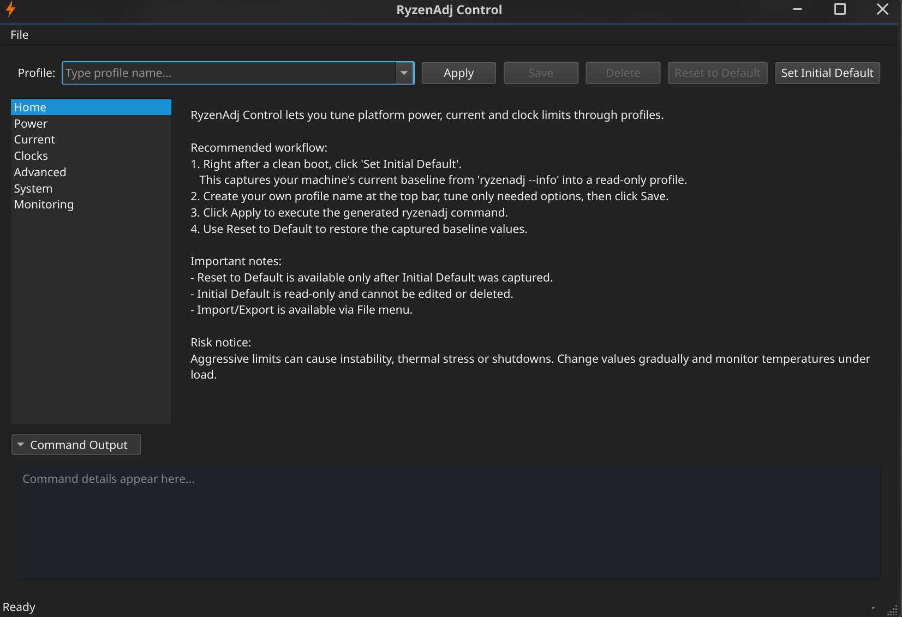
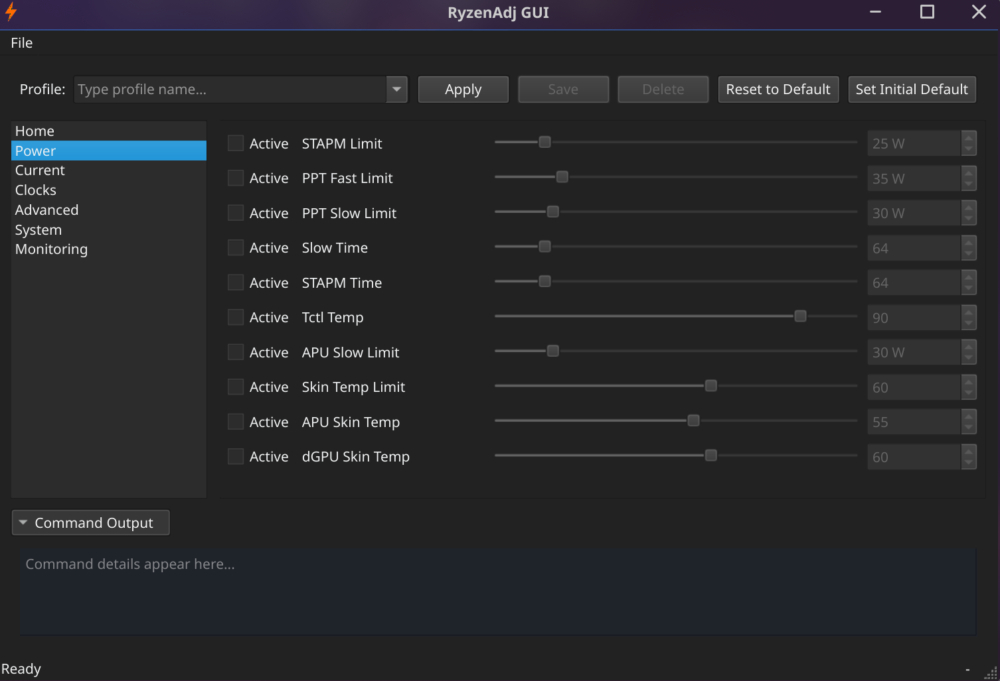
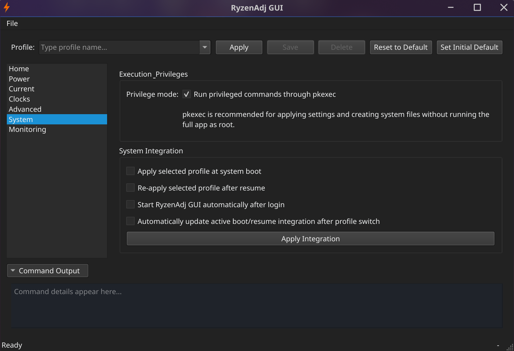

# ryzenadj-control

Native PyQt6 frontend for `ryzenadj` on Linux.

## Features

- Native Qt6 GUI (PyQt6), lightweight and fast
- Profile management: create, save, load, delete, import/export (menu button left of `Profile`)
- Stock values captured from `ryzenadj --info` on first start; `Apply` stays locked until captured
- `Restore Stock` applies the captured stock values and removes active boot/resume/re-apply integration
- Full tuning pages for power/current/clocks/advanced options
- Per-setting enable checkbox
- Non-blocking command execution with command output panel
- `pkexec` support for privileged operations
- System integration via checkboxes + `Apply Integration`:
  - apply selected profile at boot
  - re-apply after resume
  - periodically re-apply (for firmware that resets limits, e.g. ThinkPads with AMD PMF)
  - start GUI automatically after login
- Integration uses systemd (service, sleep hook, timer); without systemd (e.g. OpenRC) it falls back to cron (`/etc/cron.d`, e.g. cronie) for boot and periodic re-apply (minimum 1 minute) and elogind for resume
- Integration state is detected at app startup
- Optional auto-sync of active boot/resume/re-apply integration after Apply
- Monitoring page with `ryzenadj --info`

## Screenshots

### Home



### Power



### System Integration



## Dependencies (Required)

Install required runtime dependencies before installation:

**Important:**

- `ryzenadj` must be installed, either in `PATH` or in a standard location such as `/usr/local/bin` or `/usr/bin`.
- `pkexec` must work, otherwise privileged apply/integration actions will fail.

Check `ryzenadj`:

```bash
ryzenadj --version
```

Check `pkexec`:

```bash
pkexec /usr/bin/id
```

## Installation

### Arch Linux (AUR)

The package is available in the Arch User Repository (AUR).

**Package name:** `ryzenadj-control`

Install with `yay`:

```bash
yay -S ryzenadj-control
```

Or with `paru`:

```bash
paru -S ryzenadj-control
```

Manual installation:

```bash
git clone https://aur.archlinux.org/ryzenadj-control.git
cd ryzenadj-control
makepkg -si
```

### Ubuntu / Debian

The `.deb` package is published in GitHub Releases:

`https://github.com/h4us0x/ryzenadj-control/releases`

Download the latest `ryzenadj-control_<version>_amd64.deb` and install it:

```bash
sudo dpkg -i ryzenadj-control_<version>_amd64.deb
sudo apt -f install
```

## Development

Development dependencies (Arch Linux):

```bash
sudo pacman -S python-pyqt6 ryzenadj polkit
```

Run from source:

```bash
python main.py
```

## Profile Storage

Profiles are saved in:

```text
~/.config/ryzenadj-control/profiles.json
```

Notes:

- User profiles are visible in the profile selector.
- Stock values are stored internally as `Initial Default` and hidden from normal profile selection.
- `Restore Stock` is available after `Capture Stock Values`. Re-capture via the menu button left of `Profile` (only right after a clean boot).

## Troubleshooting

- `ryzenadj was not found`: install `ryzenadj` into `PATH` or `/usr/local/bin`, then restart the app.
- Apply does nothing: enable at least one setting before `Apply`.
- Permission errors: enable `pkexec` in System tab.
- Monitoring values show `N/A`: inspect raw `--info` output in Monitoring.
- `Unable to init power metric table`: load the `ryzen_smu` kernel module (e.g. `ryzen_smu-dkms-git`) or boot with `iomem=relaxed`. After kernel updates, check that DKMS rebuilt the module (`dkms status`).
- Limits are reset after a while: enable periodic re-apply on the System page.
- Some values are reported as unsupported: app may still apply remaining supported values.

## Disclaimer

This application interfaces with `ryzenadj` and allows modifying CPU power, current and related performance parameters.

Altering these values may impact system stability, thermals, performance characteristics and potentially hardware longevity.

This software is provided without warranty.  
Use it at your own risk and ensure you understand the effects of the parameters you modify.

## Development & Testing

This project was developed and tested on:

- Arch Linux  
- AMD Ryzen™ AI Max+ 395  

Core functionality — including applying selected `ryzenadj` parameters — has been verified on this system.

However, only a subset of parameters has been actively tested.  
Behavior may vary depending on hardware, firmware, kernel version and `ryzenadj` support.

If you encounter issues on other Ryzen-based systems, please report them.

## Acknowledgements

This project builds upon the work of the developers behind `ryzenadj` and related Ryzen Linux tooling.

Special thanks to the maintainers of:

- `ryzenadj`

## License

This project is licensed under the MIT License. See `LICENSE`.
